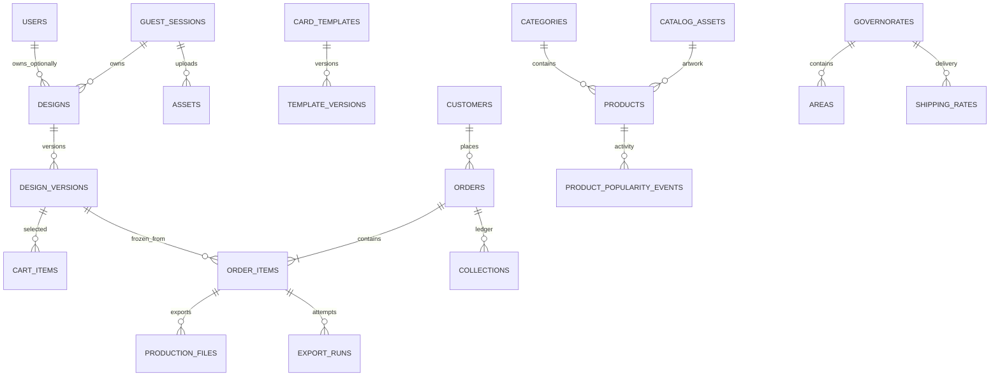

# بنية البيانات

المخطط ينشأ من migrations، ولا يحتاج SQL يدوياً لإنشاء الجداول. مبالغ IQD أعداد صحيحة في حقول مالية أو JSON ثابت، دون floating point للتسعير. UUID للتصاميم والجلسات والطلبات، ورموز استعادة/متابعة 256-bit محفوظة كبصمات، وليست أرقام الطلب وحدها وسيلة وصول.

| الجداول | الوظيفة |
|---|---|
| users | حسابات اختيارية وأدوار admin/orders/production/customer |
| guest_sessions | هوية الضيف وبصمة الاستعادة |
| customers | بيانات تواصل الطلب، منفصلة عن الحساب الاختياري |
| products, categories, catalog_assets | الكتالوج وصورة العرض والأصل الخاص؛ is_featured تمييز إداري وdeleted_at حذف محفوظ؛ popularity_count مجموع أحداث الشعبية المثبتة |
| product_popularity_events | أحداث cart/order دون بيانات عميل، مع source_key فريد يمنع تضخيم العدّاد عند الإعادة؛ تبقى بعد حذف السلة |
| materials, finishes | التوفر والمواصفات والإضافات |
| card_templates, template_versions | نوع قالب الأمام small_chip/no_chip، وهندسة وإصدار واعتماد وتوافق لكل جهة؛ الإصدارات المؤرشفة محفوظة |
| designs, design_versions | مسودة حالية وإصدارات مستقلة للرسم والخيارات والقوالب |
| assets | PNG خاص مع أبعاد وبصمة ومالك؛ source يميّز upload عن catalog، وقيد فريد للجلسة والبصمة والمصدر |
| cart_items | مرجع إصدار محدد وكمية؛ قيد يمنع تكرار الإصدار في سلة الضيف |
| orders, order_items | طلب وإجماليات وعنوان ثابت، ونسخة إنتاج مستقلة لكل بند |
| production_files, export_runs | الملفات والبصمات ومحاولات التصدير وحالاتها |
| governorates, areas, shipping_rates | تغطية قابلة للتحديث وأجرة ومدة فعلية |
| coupons, bundles | خصومات محدودة وباقات تلقائية |
| collections | تحصيل ومبالغ معادة مع مرجع فريد لكل نوع/طلب |
| settings, content_pages | تشغيل المتجر والتسعير والروابط والسياسات والأسئلة |
| audit_logs, review_requests | إجراءات الموظفين ومراجعات القوالب |
| jobs, job_batches, failed_jobs, cache, sessions | بنية Laravel للـQueue والجلسات والمعدل |

خيارات الجهات والطبقات وإصدارات القوالب تحفظ كبيانات JSON محققة خادمياً. يتضمن كل عنصر نوعاً ومعرفاً وتحويلات بالملليمتر ونصاً/خطاً أو معرف أصل. لا يقبل الخادم شجرة SVG تنفيذية من العميل، ولا يقبل سعراً محسوباً من المتصفح.

الحفظ يستخدم رقماً متوقعاً للإصدار وقفل صف. إعادة إرسال البيانات نفسها لا تنشئ إصداراً مكرراً. تغيير مسودة من نافذتين يعيد تعارضاً واضحاً ويحافظ على النسخة المحلية. تأكيد الطلب معاملة واحدة، بمفتاح idempotency لكل جلسة، وقفل يمنع تكرار الطلب واستهلاك الخصم عند إعادة المحاولة.

نسخة بند الطلب تشمل وثيقة التصميم وإصداره، وهندسة كل قالب وإصداره واعتماده، والأصول المنسوخة المستقلة وبصماتها، والخامات والتشطيب والسعر وإعداد المطبعة. النموذج يمنع تعديل حقول البند المثبتة من التطبيق. الحذف وفق الاحتفاظ إجراء صيانة صريح يسجّل انتهاء الاحتفاظ، ويحجب إعادة التصدير بعد إزالة الأصول.

تسجيل حدث الشعبية وزيادة عدّاد المنتج عملية ذرية ضمن معاملة الإضافة أو الطلب. مفتاح إضافة السلة مرتبط بإصدار التصميم، ومفتاح الطلب يجمع الطلب والمنتج؛ لا تحتسب تحديثات الكمية أو تكرار المنتج داخل الطلب كطلبات مستقلة. يتأهل المنتج النشط عندما يكون `popularity_count > 10`، مع فهرس للترتيب والتصفية.

تفصل أصول `upload` القابلة للتحرير عن نسخ `catalog` المقفلة حتى عندما تتطابق البايتات. التحقق يعتمد على المصدر المثبت خادمياً، مع استمرار التحقق من الملكية. الترحيل يحافظ على قفل الملفات القديمة المطابقة للكتالوج؛ الرفع الشخصي المؤكد ينشئ مرجعاً مستقلاً، ويمكن تصحيح مراجع المسودة النشطة دون تغيير إصدارات الطلب. إزالة هذا الترحيل تُرفض عندما توجد صورتان بالبصمة نفسها ومصدرين مختلفين، لتجنب دمج أو حذف ملفات مرتبطة بتصاميم ثابتة.

## أقسام الأجهزة وطلبات التسعير

`product_sections` يحفظ وصف القسم وترتيبه وحالة نشره والرسم التوضيحي وشرط إدخال الموديل. الحقل `products.product_section_id` اختياري: `NULL` يعني ستيكر بطاقة، وقيمة غير فارغة تعني منتجاً من الأقسام الجديدة بمسار تسعير مستقل. لا تتغير ارتباطات الطلبات التاريخية أو قوالبها.

`catalog_requests` يحفظ الموديل والكمية والمقاسات والاتصال والتفاصيل، مع نسخة من أسماء القسم والمنتج وقت الإرسال. معرّف الطلب UUID، ومعرّف الإرسال فريد لمنع التكرار، وبصمة البيانات تمنع استبدال المحتوى بإعادة الإرسال. ربط جلسة الضيف والتحقق من مساحة الزائر يمنعان استخدام طلب زائر آخر أو نموذج قديم بعد تبديل الجلسة. السعر الإداري عدد صحيح بالدينار، والحالة منفصلة عن حالات الطلبات والإنتاج والتحصيل. لا يوجد مسار عام يعرض بيانات طلب التسعير برقم مرجعي.

## المحاسبة والمخزن

الجداول الجديدة: `stock_items` لتعريف الوحدات وأبعاد الورق والرصيد والقيمة، `accounting_entries` للمشتريات والمصاريف ورأس المال، `accounting_payments` للدفعات، `stock_movements` للحركات، `cost_recipes` لإعدادات الحساب، و`cost_runs` لدفعات الاستهلاك ونسخ كلفتها المثبتة. تُضاف دون تغيير الطلبات أو الأسعار أو القوالب الموجودة. Seeder المواد ينشئ تعريفَي ورق A4 والحبر برصيد وقيمة صفر.

مبالغ الفواتير والمدفوعات أعداد صحيحة بالدينار. كمية المواد وقيمتها أعداد صحيحة مضروبة في 1000، وليست floating point. يسجل كل إدخال شراء كامل الكمية والقيمة، والاستهلاك يسحب من متوسط قيمة الرصيد بتقريب إلى 0.001 دينار. عند نفاد الرصيد تبقى آخر قاعدة تقييم لتقدير كلفة إنتاج لاحق مع إعلان نقص المخزن. الحساب الوسيط يستخدم الأعداد الصحيحة الدقيقة من `brick/math` المثبت في المشروع.

حركات المخزن والدفعات غير قابلة لإعادة الكتابة أو الحذف عبر النماذج. حقول أصل الفاتورة ونسخة الإنتاج ثابتة، مع حقول منفصلة للمدفوع المتراكم والإلغاء. فواتير وحركات ودفعات الإنتاج لها مفاتيح إرسال فريدة؛ البصمة أو مقارنة بيانات الدفعة تمنع إعادة استخدام المفتاح لمحتوى مختلف. التحديثات تتم بمعاملات وقفل صفوف؛ الإنتاج يقفل جميع المواد بترتيب المعرّفات ويتحقق من كفايتها قبل الخصم. إعادة المحاولة لا تنشئ نسخة إضافية.

كل حركة تحفظ الرصيد بعدها وقاعدة التقييم قبلها. الحركة العكسية ترتبط بـ`reversal_of` فريد؛ عكس أحدث حركة أصلية غير معكوسة يعيد قيمتها وقاعدة تقييمها الأصلية، ثم يسمح بعكس الأقدم. المراجع المالية محفوظة بـUUID، وصلاحية الإدارة والتحقق الخادمي مطلوبة لجميع المسارات. يشمل سجل الإجراءات الإنشاء والدفعات والاستهلاك والإلغاء. النسخ الاحتياطية المعتادة لقاعدة البيانات تشمل هذه الجداول تلقائياً.

## استلام مسؤول التوصيل

تضيف migration `2026_10_26_144534_add_shipping_receipt_to_orders_table` الحقلين الاختياريين `orders.shipping_received_at` و`orders.shipping_received_by` (مرجع مستخدم مع `SET NULL` عند حذف الحساب). تبقى الطلبات القديمة بحالاتها الأصلية. يسجل الاستلام تحت قفل صف الطلب، ولا يستبدل أول مستلم عند إعادة الطلب. العودة من جاهز للشحن إلى مراجعة التصميم تمسح الاستلام الحالي فقط؛ تبقى أحداث `order.shipping_received` و`order.status` في سجل الإجراءات. يسجل `production.download_requested` رقم الملف ونوعه وجهته وربطه بالطلب دون نسخ الملفات أو تغيير نسخ التصميم.

الدور `shipping` قيمة جديدة في عمود `users.role` النصي القائم؛ لا ينشئ الترحيل مستخدمين ولا يرقّي حساباً بالاسم. أسماء جواد ومهند وجعفر معرفة كعناوين مراحل في `OrderWorkflow`، والحساب المنفذ الحقيقي محفوظ في سجل الأحداث.

## مصادر الكتالوج والتصنيفات المتعددة

تضيف migration `2026_10_26_153416_add_catalog_sources_and_product_categories` الحقول `products.catalog_source` و`catalog_source_id` مع قيد فريد مركب، و`catalog_metadata` لتتبع المصدر وخيار الصورة والتصنيف وجودة المقاس ومراجعة المصدر. جدول `category_product` يربط المنتج بعدة تصنيفات دون إزالة `products.category_id` الأساسي؛ فلتر المعرض يبحث في الرابطين. لا تتغير بيانات نسخ التصميم أو الطلبات المثبتة، ولا ترتبط شعبيتها بترتيب متجر المصدر.

الاستيراد يحفظ الصورة الخاصة وWebP العرض ويستخدم معاملة لكل منتج وروابط تصنيفاته، مع سجل `catalog.licensed_import`. يزيل سجلات الأصول والجلسة المؤقتة بعد المعالجة. إعادة التنفيذ لا تعيد نشر محذوف أو تستبدل حقول المالك. الملفات والمسارات خارج مجلد البيان مرفوضة. بيانات التحميل وملف البيان والتقارير ونسخة ما قبل الاستيراد محفوظة ضمن تخزين التطوير الخاص وغير مضافة إلى Git.
