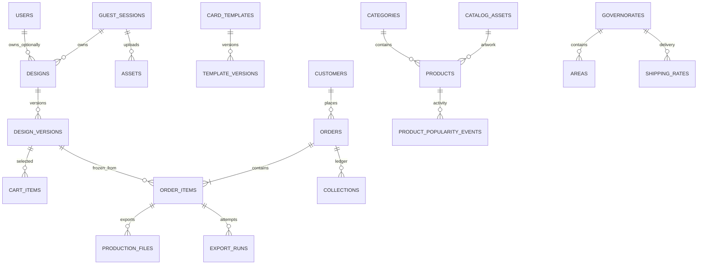

# بنية البيانات

المخطط ينشأ من migrations، ولا يحتاج SQL يدوياً لإنشاء الجداول. مبالغ IQD أعداد صحيحة في حقول مالية أو JSON ثابت، دون floating point للتسعير. UUID للتصاميم والجلسات والطلبات، ورموز استعادة/متابعة 256-bit محفوظة كبصمات، وليست أرقام الطلب وحدها وسيلة وصول.

| الجداول | الوظيفة |
|---|---|
| users | حسابات اختيارية وأدوار admin/orders/production/customer |
| guest_sessions | هوية الضيف وبصمة الاستعادة |
| customers | بيانات تواصل الطلب، منفصلة عن الحساب الاختياري |
| products, categories, catalog_assets | الكتالوج وصورة العرض والأصل الخاص؛ popularity_count مجموع أحداث الشعبية المثبتة |
| product_popularity_events | أحداث cart/order دون بيانات عميل، مع source_key فريد يمنع تضخيم العدّاد عند الإعادة؛ تبقى بعد حذف السلة |
| materials, finishes | التوفر والمواصفات والإضافات |
| card_templates, template_versions | هندسة وإصدار واعتماد وتوافق لكل جهة |
| designs, design_versions | مسودة حالية وإصدارات مستقلة للرسم والخيارات والقوالب |
| assets | PNG خاص مع أبعاد وبصمة ومالك؛ source يميّز upload عن catalog، وقيد فريد للجلسة والبصمة والمصدر |
| cart_items | مرجع إصدار محدد وكمية؛ قيد يمنع تكرار الإصدار في سلة الضيف |
| orders, order_items | طلب وإجماليات وعنوان ثابت، ونسخة إنتاج مستقلة لكل بند |
| production_files, export_runs | الملفات والبصمات ومحاولات التصدير وحالاتها |
| governorates, areas, shipping_rates | تغطية قابلة للتحديث وأجرة ومدة فعلية |
| coupons, bundles | خصومات محدودة وباقات تلقائية |
| collections | تحصيل ومبالغ معادة مع مرجع فريد لكل نوع/طلب |
| settings, content_pages | تشغيل المتجر والتسعير والروابط والسياسات والأسئلة |
| audit_logs, review_requests | إجراءات الموظفين ومراجعات القوالب |
| jobs, job_batches, failed_jobs, cache, sessions | بنية Laravel للـQueue والجلسات والمعدل |

خيارات الجهات والطبقات وإصدارات القوالب تحفظ كبيانات JSON محققة خادمياً. يتضمن كل عنصر نوعاً ومعرفاً وتحويلات بالملليمتر ونصاً/خطاً أو معرف أصل. لا يقبل الخادم شجرة SVG تنفيذية من العميل، ولا يقبل سعراً محسوباً من المتصفح.

الحفظ يستخدم رقماً متوقعاً للإصدار وقفل صف. إعادة إرسال البيانات نفسها لا تنشئ إصداراً مكرراً. تغيير مسودة من نافذتين يعيد تعارضاً واضحاً ويحافظ على النسخة المحلية. تأكيد الطلب معاملة واحدة، بمفتاح idempotency لكل جلسة، وقفل يمنع تكرار الطلب واستهلاك الخصم عند إعادة المحاولة.

نسخة بند الطلب تشمل وثيقة التصميم وإصداره، وهندسة كل قالب وإصداره واعتماده، والأصول المنسوخة المستقلة وبصماتها، والخامات والتشطيب والسعر وإعداد المطبعة. النموذج يمنع تعديل حقول البند المثبتة من التطبيق. الحذف وفق الاحتفاظ إجراء صيانة صريح يسجّل انتهاء الاحتفاظ، ويحجب إعادة التصدير بعد إزالة الأصول.

تسجيل حدث الشعبية وزيادة عدّاد المنتج عملية ذرية ضمن معاملة الإضافة أو الطلب. مفتاح إضافة السلة مرتبط بإصدار التصميم، ومفتاح الطلب يجمع الطلب والمنتج؛ لا تحتسب تحديثات الكمية أو تكرار المنتج داخل الطلب كطلبات مستقلة. يتأهل المنتج النشط عندما يكون `popularity_count > 10`، مع فهرس للترتيب والتصفية.

تفصل أصول `upload` القابلة للتحرير عن نسخ `catalog` المقفلة حتى عندما تتطابق البايتات. التحقق يعتمد على المصدر المثبت خادمياً، مع استمرار التحقق من الملكية. الترحيل يحافظ على قفل الملفات القديمة المطابقة للكتالوج؛ الرفع الشخصي المؤكد ينشئ مرجعاً مستقلاً، ويمكن تصحيح مراجع المسودة النشطة دون تغيير إصدارات الطلب. إزالة هذا الترحيل تُرفض عندما توجد صورتان بالبصمة نفسها ومصدرين مختلفين، لتجنب دمج أو حذف ملفات مرتبطة بتصاميم ثابتة.
